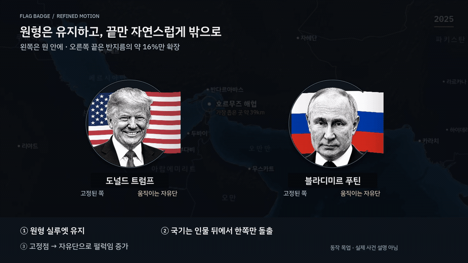
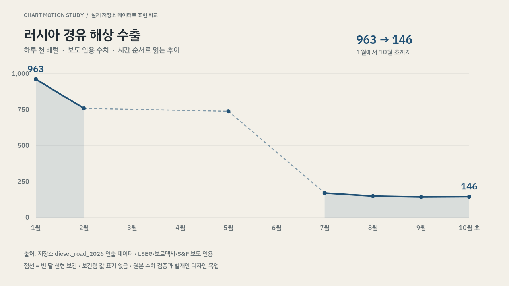

<!--
last_synced_with: v7.4.1
-->
# 배지·차트 디자인 목업

압축하지 않은 개별 파일입니다. GitHub에 로그인한 브라우저에서 아래 파일을 열 수 있습니다. MP4 파일 페이지의 다운로드 버튼으로 원본을 저장할 수 있습니다.

## 원형을 살린 국기 배지 — 최신 수정안

- [움직이는 GIF](flag_badge.gif)
- [MP4 영상 — 6초, 1280×720, 30fps, H.264](flag_badge.mp4)
- [정지 미리보기 PNG](flag_badge.png)

왼쪽은 원형 안에 두고 오른쪽 끝만 원 밖으로 조금 나옵니다. 인물과 이름표는 고정하고 국기 자유단으로 갈수록 펄럭임을 키웁니다. 3초 주기가 두 번 반복됩니다. 이 영상은 구도와 움직임을 보는 확대 목업으로, 화면상의 배지 확대율을 재는 비교판은 아닙니다.

## 차트 애니메이션

- [차트 MP4 — 6초, 1280×720, 25fps, H.264](chart_animation.mp4)
- [정지 미리보기 PNG](chart_animation.png)

선 그리기 → 핵심 수치 등장 → 최종 상태 유지 순서입니다. 빈 달 보간은 점선으로 구분하고 보간값에는 값 라벨을 붙이지 않았습니다. 설명 패널은 차트 위에 겹치지 않습니다.

참고: [Report Design Sheet v8.6.0](https://doroper98.github.io/agents_reviewer/samples/report_design_sheet_v8_6_0.html)의 차트·모션 절.

## 자산·검증 범위

- 인물 사진은 이 저장소의 `assets/library/people/trump_mono_v01.png`, `putin_mono_v01.png`를 사용했습니다. 원본 출처·권리 이력은 `assets/library/library_manifest.json`을 따릅니다.
- 국기는 저장소 `assets/flags/legacy_svg/`의 기존 자산을 사용했습니다.
- 지도 바탕은 저장소 골든 `frame_0028.77.png`입니다. 인물 간 실제 사건이나 관계를 설명하는 장면이 아닙니다.
- 차트는 `projects/diesel_road_2026/direction.yaml`의 러시아 경유 해상 수출 데이터를 재사용했습니다. 원본 수치에 대한 별도의 사실 검증을 의미하지 않습니다.
- 두 MP4는 전체 디코딩 검사를 통과했습니다. 국기 자유단의 프레임 변화와 고정점, 3초 주기 일치를 확인했습니다.
- 운영 렌더 코드·규칙 통합 및 기존 완성 영상 교체는 포함하지 않습니다.
